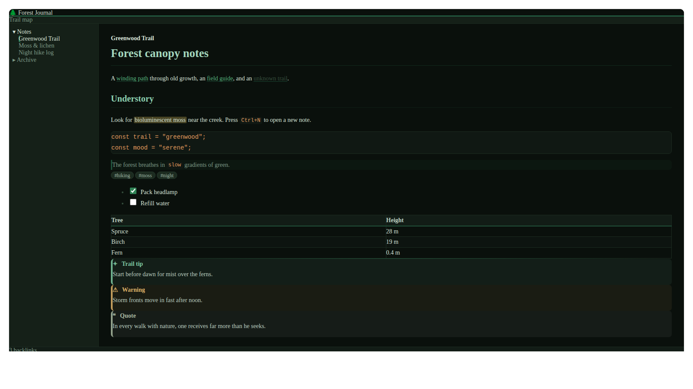

# Verdant

A dark aesthetic, forest-green theme for [Obsidian](https://obsidian.md) — deep green-black surfaces, a muted moss accent, and soft sage text. Verdant ships with both a **dark** and a **light** (misty forest morning) mode.



> Replace `screenshots/screenshot.png` with a 16:9 screenshot (recommended: 512×288 or larger) of your theme before submitting.

---

## Features

- Complete dark and light modes with a green-tinted neutral scale (no pure gray, no pure white)
- Deep forest-green accent color that works for buttons, toggles, active states, and selections
- Tuned syntax highlighting palette for code blocks and inline code (Obsidian's `--code-*` variables)
- Themed callouts: all built-in callout types get forest-friendly colors in both modes
- Serif reading font (Georgia / system serif) paired with a clean system UI font — zero network requests
- Custom styling for tabs, ribbon, status bar, file explorer, search, quick switcher, menus, modals, settings, tables, tags, blockquotes, embeds, and scrollbars
- Accessible extras: respects `prefers-reduced-motion`, includes print styles

## Palette

| Role | Dark | Light |
| --- | --- | --- |
| Background | `#0a100c` | `#f5f9f3` |
| Secondary background | `#152018` | `#dde6d9` |
| Borders | `#1c2b20` | `#c9d6c5` |
| Text | `#d7e2d9` | `#1f2c20` |
| Muted text | `#7d9a87` | `#596c56` |
| Accent | `#2f825c` | `#296549` |
| Links | `#55b37d` | `#246942` |
| Code strings | `#d9bd5e` | `#937b26` |
| Callout warning | `#dfb268` | `#b5763a` |

## Installation

### After approval in the Community Themes directory

1. Open **Settings → Appearance → Themes**
2. Pick **Verdant** from the list and enable it

### Manual installation (testing)

1. Copy `manifest.json` and `theme.css` into `<vault>/.obsidian/themes/Verdant/`
2. Enable the theme under **Settings → Appearance → Themes**

## Customization

Verdant is built on Obsidian's standard CSS variables. To tweak it, either edit the palette at the top of `theme.css` or use the [Style Settings](https://github.com mgmeyers/obsidian-style-settings) plugin with your own snippet. Useful knobs:

- `--accent-h`, `--accent-s`, `--accent-l` — the accent color in HSL
- `--color-base-00` … `--color-base-100` — the surface/text scale
- `--verdant-heading-1` … `--verdant-heading-6` — heading colors
- `--radius-s`, `--radius-m`, `--radius-l` — corner rounding

## Development

```bash
npm install
npm run lint
```

The lint step uses [`stylelint-config-obsidianmd`](https://github.com/obsidianmd/stylelint-config), the same rules the Community Themes reviewers apply. Keep `theme.css` free of `!important`, external URLs, `:has()`, and named colors.

## Releasing a new version

1. Bump the version in `package.json` (and update `manifest.json` via the helper):

   ```bash
   npm version patch   # or minor / major
   ```

   This runs `version-bump.mjs`, which syncs `manifest.json` and `versions.json`.

2. Commit and push a matching tag:

   ```bash
   git commit -am "Release vX.Y.Z"
   git tag vX.Y.Z
   git push && git push --tags
   ```

3. The `Release Obsidian theme` GitHub Action creates a **draft** release with `manifest.json` and `theme.css` attached. Publish the draft on GitHub.

## Submitting to the Community Themes directory

1. Push this repository to GitHub (name it e.g. `obsidian-verdant-theme`).
2. Fill in the placeholders: `name`, `author`, and `authorUrl` in `manifest.json`, and the copyright holder in `LICENSE` and `README.md`.
3. Add a 16:9 screenshot at `screenshots/screenshot.png`.
4. Publish a GitHub release whose tag matches `manifest.json`'s `version` (see above).
5. Go to [community.obsidian.md](https://community.obsidian.md) → **Themes → New theme**, and submit:
   - the repository URL,
   - your GitHub username as owner,
   - the screenshot path (`screenshots/screenshot.png`),
   - the supported modes: `dark` and `light`.

The directory reads `manifest.json` from the default branch, and users install `manifest.json` + `theme.css` from the matching release — so keep both in the repo root and always release via tags.

## License

[MIT](LICENSE)
